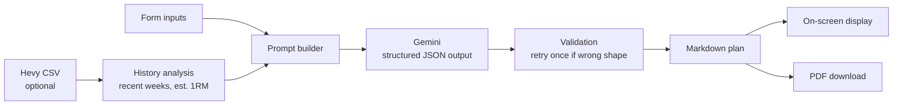

# 🏋️ AI Workout Planner

A free, web-based workout planner built with [Streamlit](https://streamlit.io) and Google's Gemini API. Tell it about your goals, schedule and equipment, optionally upload your [Hevy](https://www.hevyapp.com) workout history, and get a personalised multi-week training plan you can read on screen or download as a PDF.

<!-- Add your live app link here, e.g. **Live app:** https://your-app-name.streamlit.app -->

## Features

- **Personalised plans** based on age, gender, fitness level, goals, equipment, training days, session length and (optionally) bodyweight.
- **Hevy integration.** Upload your exported workout CSV and the app uses your *recent* training to set realistic starting loads (estimated 1RM, typical working weights, training frequency).
- **Structured, progressive programming.** Week 1 is written out in full, followed by a week-by-week progression table with effort (RIR) targets and a deload week every 4th week for plans of 5+ weeks.
- **Safety-aware.** Handles injuries and excluded exercises first, respects your equipment and session length, and applies extra limits for users under 18. Any inputs the AI had to override are listed in the plan.
- **PDF export** with formatted tables.
- **Built-in protections** for the shared API key: per-visitor cooldown plus global rate limits.
- **Teal, blue and grey theme** configured in `.streamlit/config.toml`.

## How it works



1. **Inputs** are collected in the Streamlit form.
2. **History analysis** (if a CSV is uploaded) looks at working sets from the last 8 weeks (widening to 16 or 52 weeks if data is sparse), computes an estimated 1RM using the Epley formula, and keeps the 30 most-performed exercises. If your last workout was more than 6 weeks ago, the AI is told to start lighter.
3. **Prompt building** combines a system instruction (coach role, safety rules, constraint priorities) with your inputs, clearly separated as data.
4. **Gemini** returns JSON that matches a schema (`WorkoutPlan` in `app.py`). The app validates it, retries once if the number of sessions or weeks is wrong, and enforces the facts it knows for certain (your training days, deload weeks).
5. **Rendering** turns the structured plan into Markdown for the screen and into a PDF with ReportLab.

## Getting started

### Prerequisites

- Python 3.11 or newer (the pinned `numpy` 2.x requires it)
- A Gemini API key from [Google AI Studio](https://aistudio.google.com/apikey)

### Run locally

```bash
git clone <your-repo-url>
cd <your-repo-folder>

python -m venv .venv
source .venv/bin/activate        # Windows: .venv\Scripts\activate
pip install -r requirements.txt
```

Create `.streamlit/secrets.toml` (this file must **not** be committed):

```toml
GOOGLE_API_KEY = "your-gemini-api-key"
```

Then start the app:

```bash
streamlit run app.py
```

### Deploy for free on Streamlit Community Cloud

1. Push this repo to GitHub (make sure `.streamlit/secrets.toml` is git-ignored).
2. Sign in at [share.streamlit.io](https://share.streamlit.io) and choose **New app**.
3. Select your repo and branch, and set the main file path to `app.py`.
4. Under **Advanced settings → Secrets**, paste:
   ```toml
   GOOGLE_API_KEY = "your-gemini-api-key"
   ```
5. Click **Deploy**.

Community Cloud apps have limited memory (about 1 GB) and go to sleep after a period without traffic. The next visitor just waits a few seconds for the app to wake up.

## Project structure

```
.
├── app.py                    # The whole app: UI, prompting, Gemini call, PDF
├── requirements.txt          # Python dependencies
├── README.md
└── .streamlit/
    ├── config.toml           # Theme (committed)
    └── secrets.toml          # API key (NOT committed)
```

> **`.gitignore` tip:** ignore only `.streamlit/secrets.toml`, not the whole `.streamlit/` folder. Otherwise the theme won't deploy.

## Configuration

Settings live as constants near the top of `app.py`.

| Setting | Default | What it does |
|---|---|---|
| `AVAILABLE_MODELS` / `DEFAULT_MODEL` | see file | Gemini models offered in the dropdown. Check these against the models currently available to your API key. |
| `CLIENT_COOLDOWN_SECONDS` | `60` | Minimum gap between plans for one visitor (tracked by session and IP). |
| `GLOBAL_MAX_PER_MINUTE` | `10` | Max plans per minute across all visitors. |
| `GLOBAL_MAX_PER_DAY` | `200` | Max plans per rolling 24 hours across all visitors. Keep this below your Gemini quota. |
| `MAX_OUTPUT_TOKENS` | `32768` | Output limit for each plan. Lower it if a model rejects the value. |
| `MAX_EXERCISES_IN_PROMPT` | `30` | How many exercises from the Hevy history are sent to the AI. |
| `RECENT_WINDOW_WEEKS` | `(8, 16, 52)` | Training windows used for capability figures, tried in order. |
| `STALE_AFTER_DAYS` | `42` | After this many days without training, the AI is told to start lighter. |

The colour palette constants (`TEAL`, `BLUE`, `NAVY`, ...) are used for the banner and PDF. Keep them in sync with `.streamlit/config.toml`, which controls the Streamlit widgets.

## Hevy CSV format

In Hevy: **Profile → Settings → Export & Import Data → Export Data → Export Workouts**.

The app requires the columns `exercise_title` and `start_time`. It also uses `set_type`, `weight_kg` and `reps` when present. Warm-up and drop sets are ignored; normal and failure sets count as working sets.

## Rate limiting

To protect the shared API key, `RateLimiter` enforces the cooldown and global caps described above. It is held in memory, so counters reset whenever the app restarts or wakes from sleep. Visitors on the same network (for example an office) share an IP, and therefore a cooldown.

## Privacy

- Everything a user enters, and any uploaded workout history, is sent to the Gemini API to generate the plan. Depending on the API plan, Google may use submitted content to improve its products. Review Google's current terms for your plan.
- The app does not store data in a database or user accounts.
- The in-app notice tells users not to include names, contact details or sensitive medical information.

## Troubleshooting

| Problem | Likely cause and fix |
|---|---|
| `ModuleNotFoundError` on startup | A package is missing from `requirements.txt`. It must include `streamlit`, `pandas`, `google-genai`, `reportlab` and `pydantic`. |
| `KeyError: 'GOOGLE_API_KEY'` | The secret isn't set. Add it to `.streamlit/secrets.toml` locally, or to the Secrets box on Community Cloud. |
| "Something went wrong while creating your plan" | Check the app logs for the real error. Common causes are an unavailable model name, an exceeded Gemini quota, or a model that rejects the output token limit. |
| "The plan was too long for the AI to finish" | Try fewer weeks, fewer training days, or a different model. |
| Theme looks default | `.streamlit/config.toml` wasn't committed (check `.gitignore`). |

## Maintenance notes

- Pin `google-genai`, `reportlab` and `pydantic` in `requirements.txt` (run `pip show <package>` to see your installed versions) so deployments stay reproducible.
- Gemini model names change over time. Update `AVAILABLE_MODELS` when they do.

## Disclaimer

Plans are generated by AI and provide general fitness information only. They are not medical advice. Anyone with an injury or health condition should consult a doctor before starting a new programme, and stop if something hurts.